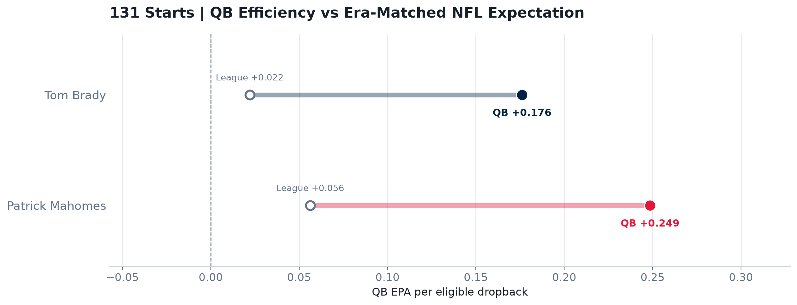
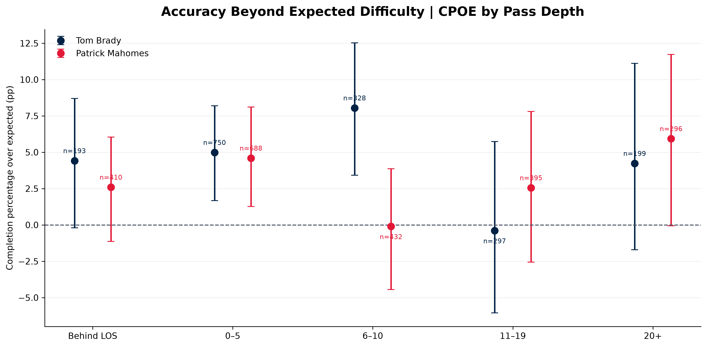
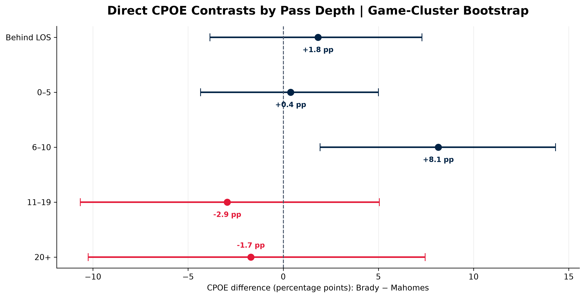

# Can the Baby GOAT Surpass the GOAT?

**Tom Brady vs. Patrick Mahomes — a reproducible, era-aware NFL analytics study**

**100 wins. 131 regular-season starts. Two different NFL eras.**

Brady and Mahomes each reached a **100–31 record in their first 131 regular-season starts**. Their identical win totals make for a compelling comparison, but wins are team outcomes. This project asks a more useful question: **how did their individual production, efficiency, and passing accuracy compare once we considered the environments in which they played?**

The answer is not a definitive GOAT ranking. It is a documented, data-driven comparison that separates **observed performance**, **era-relative efficiency**, and **model-adjusted passing accuracy**.

> **Project status:** Data pipelines, validation, descriptive analysis, era-adjusted EPA analysis, and pass-depth/CPOE analysis completed. Research findings are ready for publication; further work on team context remains optional.

## At a glance

| Research sample | Tom Brady | Patrick Mahomes |
|---|---:|---:|
| First regular-season starts | 131 | 131 |
| Wins–losses | 100–31 | 100–31 |
| Eligible dropbacks in EPA study | 4,607 | 5,381 |
| **Absolute QB EPA / dropback** | **+0.176** | **+0.249** |
| **Season-relative QB EPA / dropback** | **+0.1542** | **+0.1923** |
| **Three-year-relative QB EPA / dropback** | **+0.1526** | **+0.1945** |

*EPA values are descriptive estimates from the selected starts, not causal estimates of quarterback talent. Three-year references are based on adjacent NFL seasons and have documented edge/partial-season rules.*

### The central finding

Mahomes led in absolute QB EPA per dropback by approximately **+0.073**. After subtracting the NFL baseline matched to each season, that observed lead narrowed to **+0.0381 EPA/dropback**. A three-year NFL reference produced a similar difference of **+0.0419 EPA/dropback**.

**Mahomes retained the higher measured era-relative efficiency, but the historical adjustment substantially reduced the raw gap.** This result is stable across the two baseline definitions tested; it does not, by itself, establish statistical significance or isolate individual ability from team context.



## What we found

### 1. Identical win totals do not imply identical performance

Both quarterbacks reached 100 wins in 131 starts, but their career paths and individual production were not identical. The [descriptive analysis](notebooks/02_descriptive_analysis.ipynb) examines cumulative wins, passing production, rushing, and mobility without treating the win–loss record as an individual quarterback metric.

### 2. Era adjustment changes the size of the EPA gap

Our [era-adjusted analysis](notebooks/03_era_adjusted_analysis.ipynb) uses a league-wide, **dropback-weighted** NFL baseline for each season, rather than comparing players only against an unadjusted historical average. Eligible dropbacks include passes, sacks, and scrambles.

The analysis considers five complementary perspectives:

- **Absolute QB EPA/DB:** observed efficiency in the study starts.
- **Season-relative QB EPA/DB:** efficiency above the corresponding annual NFL baseline.
- **Three-year-relative QB EPA/DB:** efficiency above a smoothed, dropback-weighted reference.
- **Season-normalized QB EPA/DB:** the relative difference scaled by league *play-level* EPA dispersion (not a QB percentile).
- **Qualified-QB percentile:** ranking among quarterbacks meeting an explicit season-level dropback threshold.

Brady's **2007** season was an exceptional era-relative peak. Mahomes began his full-time starting career near the top of qualified-QB distributions: **100th percentile in 2018 and 2022** under the study's primary qualification rule. Percentile calculations use season-level QB samples, which are **not always restricted to the 131-start window**.

### 3. Their rushing profiles were very different

| Rushing metric — first 131 starts | Brady | Mahomes |
|---|---:|---:|
| Rushing attempts | 313 | 513 |
| Rushing yards | 580 | 2,722 |
| Scrambles as a share of rushing attempts | 18.8% | 65.1% |
| Official yards per carry | 1.85 | 5.31 |
| Yards per carry excluding kneel-downs | 3.76 | 7.24 |

Kneel-downs materially affect QB rushing averages. Scrambles are counted in official rushing production **and** in dropback-based efficiency calculations, but are not counted twice within any single metric. Historical scramble tagging required additional auditing and corrections to the dropback selection logic.

### 4. Passing accuracy depends on target depth

Because modeled completion probabilities are available for the selected historical data beginning in **2006**, the pass-depth analysis uses a **separate, narrower sample**:

| Pass-depth study | Brady | Mahomes |
|---|---:|---:|
| Selected seasons | 2006–2010 | 2018–2021 |
| Starts included from the original study | 53 | 62 |
| Official pass attempts | 1,793 | 2,310 |
| Attempts with modeled completion probability | 1,767 | 2,221 |

The analysis groups attempts by **air yards** (not yards gained after the catch): behind the line of scrimmage, 0–5, 6–10, 11–19, and 20+ yards. It compares **attempt share, completion rate, QB EPA per attempt, and completion percentage over expected (CPOE)**.

The most notable CPOE result occurred at **6–10 air yards**:

| 6–10 air yards | Brady | Mahomes |
|---|---:|---:|
| Attempts with modeled probability | 328 | 432 |
| CPOE | **+8.04 percentage points** | **−0.10 percentage points** |

The observed **Brady − Mahomes** difference was **+8.15 percentage points** (exploratory 95% game-cluster bootstrap interval: **+2.02 to +14.33 pp**). Excluding Brady's exceptional 2007 season, the point estimate remained positive (**+5.61 pp**) but its interval crossed zero (**−1.81 to +12.80 pp**).

**Interpretation:** Brady had a marked observed advantage in this particular depth range, but 2007 materially strengthened the statistical evidence. These comparisons are exploratory, are not adjusted for testing multiple depth zones, and depend on a completion-probability model whose calibration may vary across eras.

Mahomes generated more EPA per attempt in the deeper **11–19** and **20+** air-yard groups during the selected periods; this does not imply an equally large advantage in CPOE or prove superior individual deep-ball skill.





## Research design and data quality

The project uses NFL regular-season schedules, play-by-play data, and player statistics from the **nflverse / nflfastR ecosystem**. Historical box scores provide independent spot checks.

To make the analysis reproducible and auditable, the pipeline:

1. Identifies the first **131 starts** for each quarterback and preserves their individual game IDs.
2. Builds and validates official-style passing and rushing statistics at the player-game level.
3. Audits **all 262 selected starts** against weekly statistical references, with additional manual box-score checks on a sample of games.
4. Documents source anomalies, including a historical Brady/Cassel starter attribution, spike classification, a rushing touchdown credited after a lateral, and an aborted-snap yardage discrepancy.
5. Restores historically tagged scrambles omitted by the original `qb_dropback` flag before calculating league-wide and individual EPA baselines.
6. Separates the full 131-start comparison from the more restricted **pass-depth/CPOE** research sample.

The code does not silently alter raw NFL files to force agreement with a reference. Corrections, exclusions, and known limitations are documented.

**Research documentation:** [Research protocol](research_protocol.md) · [Data sources](docs/data_sources.md) · [Data dictionary](docs/data_dictionary.md) · [Data quality log](docs/data_quality_log.md) · [Era-adjusted report](docs/era_adjusted_analysis_final_report.md) · [CPOE methodology](docs/pass_depth_cpoe_methodology.md) · [CPOE robustness methodology](docs/cpoe_robustness_methodology.md)

## Explore the analyses

| Notebook | What it covers |
|---|---|
| [`02_descriptive_analysis.ipynb`](notebooks/02_descriptive_analysis.ipynb) | 100-win pace, raw passing production, rushing, and mobility |
| [`03_era_adjusted_analysis.ipynb`](notebooks/03_era_adjusted_analysis.ipynb) | Annual and three-year EPA baselines, career evolution, normalization, and qualified-QB percentiles |
| [`04_pass_depth_and_accuracy.ipynb`](notebooks/04_pass_depth_and_accuracy.ipynb) | Pass-depth tendencies, EPA/attempt, CPOE, model expectations, bootstrap uncertainty, and 2007 sensitivity |

Charts are exported to [`reports/figures/`](reports/figures/). Data construction and audit logic live in [`scripts/`](scripts/); technical definitions and decisions live in [`docs/`](docs/).

## Reproduce the results

**Requirements:** Python environment with the dependencies in `requirements.txt`, plus access to the historical nflverse data used by the project.

From the repository root:

```bash
python -m pip install -r requirements.txt
python scripts/download_data.py

# Construct and validate the study sample
python scripts/create_master_table.py
python scripts/create_player_stats.py
python scripts/validate_passing_stats.py
python scripts/create_rushing_stats.py
python scripts/validate_rushing_stats.py
python scripts/build_complete_qb_stats.py

# Build era-matched efficiency datasets
python scripts/build_nfl_epa_baselines.py
python scripts/build_qb_era_adjusted_stats.py
python scripts/build_qualified_qb_percentiles.py
python scripts/build_three_year_relative_epa.py

# Build the separate target-depth and CPOE dataset
python scripts/inspect_pass_depth_cpoe.py
python scripts/build_pass_depth_cpoe.py
```

Then open the notebooks with Jupyter and run their cells in order.

```bash
jupyter lab
```

**Data snapshot:** The Mahomes 131-start sample and the **partial 2026 league reference** end on **October 18, 2026**. Re-downloading nflverse data at a later date may change the available 2026 records. Reproduction should retain the same data cutoff and methodological rules. Raw and processed datasets may be excluded from Git due to size; see the data-acquisition script and [data sources documentation](docs/data_sources.md).

## Tech stack

**Python**, **Polars**, **pandas**, **NumPy**, **Matplotlib**, **SciPy**, **Jupyter**, and nflverse/nflfastR data accessed through the project's data pipeline.

## Limitations and interpretation

- **Observational, not causal:** EPA, completion rates, and CPOE are influenced by teammates, coaching, opponents, game situations, and offensive systems.
- **Different eras:** League baselines reduce some historical differences but cannot create identical playing conditions. CPOE-model calibration across eras has not been independently established here.
- **Different denominators:** The 131-start EPA study, full-season QB percentiles, and selected-year CPOE analysis do **not** use identical game samples.
- **Uncertainty:** Bootstrap intervals describe sampling variability under the chosen resampling scheme; results are exploratory and do not adjust for all comparisons or season-level confounding.
- **Data coverage:** Historical flags and modeled completion probabilities have documented limitations, and **2026 is partial**.

**Bottom line:** Mahomes had higher measured era-relative QB EPA/dropback over the selected 131 starts. Brady showed a distinctive career trajectory, an exceptional 2007 peak, and a notable CPOE advantage at 6–10 air yards in the selected passing study. Neither result settles an all-time ranking or isolates quarterback talent from its context.

## Next steps

The current research is ready to be presented as an **exploratory data-science case study**. Possible extensions include receiver and defensive context, model calibration across eras, and uncertainty analyses under alternative career windows. These are future questions, **not prerequisites for interpreting the documented results**.
